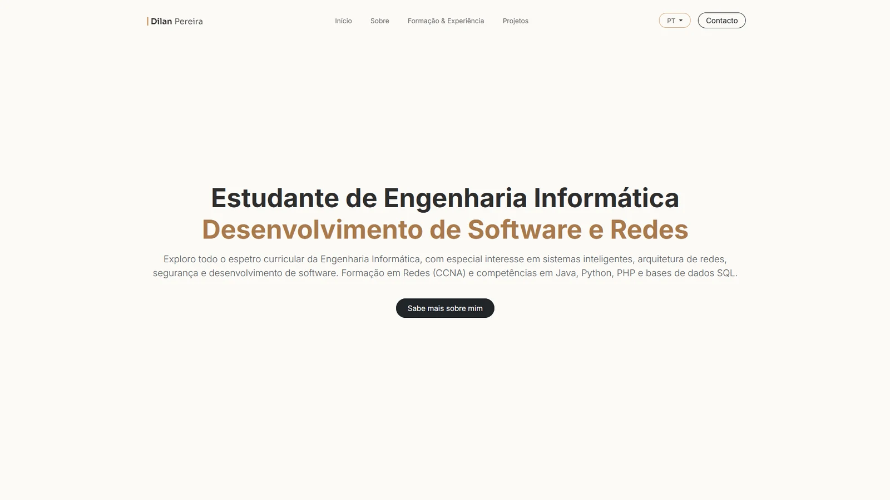

# dilanpereira.com

My personal portfolio website — built from scratch in PHP, without a framework or a database, and self-hosted on a Raspberry Pi.

**Live:** [dilanpereira.com](https://dilanpereira.com) · [Português](https://dilanpereira.com/pt/)



## Features

- **Multilingual with clean URLs** — `/`, `/pt/`, `/project/<slug>`, `/pt/projeto/<slug>`. Each language has its own address; adding a language is one line in `languages.php` plus the translations in the JSON files.
- **Front controller** — a single `router.php` resolves every page, redirects legacy URLs (301) and serves a localised 404 page.
- **Content in JSON** — projects, education and UI texts live in `assets_priv/lang/*.json`, with automatic fallback to English for missing translations.
- **SEO** — generated `sitemap.xml`, `hreflang`/canonical tags, Open Graph images per language and Schema.org structured data.
- **Contact form** — CSRF token, honeypot and time trap against bots, server-side validation, per-IP rate limiting (IPs stored only as salted hashes), messages saved as JSON Lines and push notifications through a self-hosted [ntfy](https://ntfy.sh) server.
- **Security** — strict Content-Security-Policy (no inline scripts), security headers, hardened session cookie, path normalisation against open redirects, and private code/templates kept outside the web root.
- **Performance** — versioned assets (`?v=<mtime>`) with long-term caching, gzip, deferred scripts and self-hosted fonts.
- **Maintenance mode** — a single switch (`$isWIP`) serves a 503 page with `noindex`.

## Tech

PHP 8 · Bootstrap 5 · vanilla JavaScript · Nginx + PHP-FPM (Docker) · Raspberry Pi 4 · Cloudflare Tunnel

## Project structure

```
html/            public web root (router, contact endpoint, CSS/JS/images)
assets_priv/
  pages/         page templates (home, project, 404, sitemap, maintenance)
  php/           config, routing helpers, i18n, contact form logic
  lang/          content and translations (JSON)
  tools/         CLI helper to read contact messages
deploy/          Nginx configuration used in production
```

## Running locally

Requires PHP 8.1+.

```bash
php -S localhost:8000 -t html html/router.php
```

Then open http://localhost:8000.

Optional: copy `assets_priv/php/local_config.example.php` to `assets_priv/php/local_config.php` to enable contact-form notifications.

## Deployment

In production the site runs in a `trafex/php-nginx` container on a Raspberry Pi, with `deploy/nginx.conf` mounted as the server configuration, behind Nginx Proxy Manager and a Cloudflare Tunnel (no ports open on the router).

---

© Dilan Pereira. The code is shared for reference; the personal content (texts, photos and logo) is not licensed for reuse.
